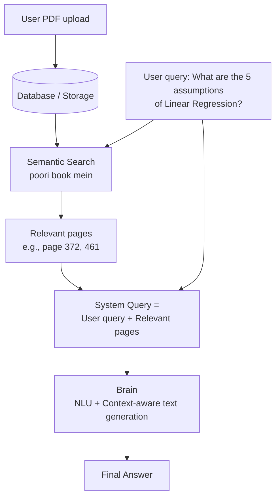
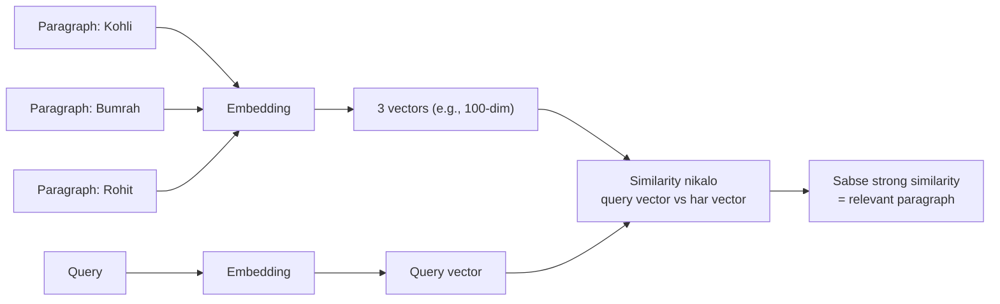
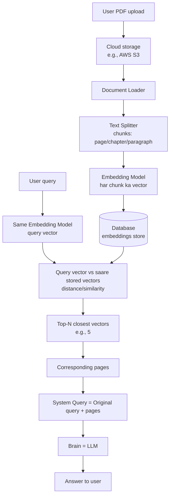

# Video 01 — Introduction to LangChain (LangChain kya hai aur zarurat kyun?)

> 🎥 Video: https://www.youtube.com/watch/nlz9j-r0U9U
> 📌 Playlist: CampusX (Nitish) — LangChain (playlist ka Video 1)
> 📝 Source: sirf is video ka transcript (author ke PDF notes use nahi hue). Is video mein **koi code nahi**, sirf concept + system design.

---

## 📑 Table of Contents

1. [LangChain kya hai?](#1-langchain-kya-hai)
2. [Running example: "PDF se baat karo" app](#2-running-example-pdf-se-baat-karo-app)
3. [High-level system design](#3-high-level-system-design)
4. [Semantic Search kaise kaam karta hai](#4-semantic-search-kaise-kaam-karta-hai)
5. [Low-level system design (detail)](#5-low-level-system-design-detail)
6. [Build karne ke 3 challenges](#6-build-karne-ke-3-challenges)
7. [LangChain ke Benefits](#7-langchain-ke-benefits)
8. [LangChain se kya bana sakte ho (Use Cases)](#8-langchain-se-kya-bana-sakte-ho-use-cases)
9. [LangChain ke Alternatives](#9-langchain-ke-alternatives)
10. [Key Takeaways](#-key-takeaways)
11. [Self-Test Questions](#-self-test-questions)

---

## 1. LangChain kya hai?

> **LangChain = ek open-source framework jisse LLM-powered applications develop karte hain.**

Agar tum koi bhi **LLM-based application** banana chahte ho, to us application ko banane mein jo framework help karta hai, wahi LangChain hai.

**Seekhne ka tareeka (speaker ka):** Kuch bhi padhne se pehle samjho ki uski **zarurat kyun thi**. Isliye pehle "LangChain ki zarurat kyun" samjhenge, phir "LangChain kya hai".

**Video ke topics:** LangChain kya → zarurat kyun → kya bana sakte ho → alternatives.

---

## 2. Running example: "PDF se baat karo" app

Speaker ka startup idea (~2014): ek aisi application jahan user **apna PDF upload kare**, usse **padh bhi sake** aur **chat feature** se PDF **se baat bhi kar sake**.

Example: Machine Learning ki book upload ki → chat se pooch sakte ho:

| User ka sawal | Kya chahiye |
|---|---|
| "Page number 5 ko aise samjhao jaise main 5 saal ka bachcha hoon" | Page 5 ka simplified summary |
| "Linear regression pe kuch **True/False questions** do, practice ke liye" | Practice questions |
| "Decision tree pe **notes** generate kar do" | Notes |

> Isi tarah ka app **incredibly useful** hai: sirf padh nahi rahe, apni book se **baat** bhi kar rahe ho.

---

## 3. High-level system design



### Step-by-step
1. User PDF upload kare → **database mein store**
2. User query poochhe: *"What are the assumptions of linear regression?"*
3. Poori book mein se pata karo ki **topic kahan** discuss hua hai → **search operation**
4. Search se 2 pages mile (e.g., page **372**, **461**)
5. In pages + user ki original query → **System Query**
6. System query → **"Brain"** (app ka sabse important component)

### Keyword Search vs Semantic Search

| | Keyword Search | **Semantic Search** |
|---|---|---|
| Kaise | Query ke **words** (e.g., "assumptions", "linear regression") ko poori book mein dhoondho | Query ka **meaning** samjho aur uske basis pe search karo |
| Problem / Fayda | "Assumptions" jaisa word kai pages mein hoga → **bahut saare unnecessary pages** (inefficient) | **Kam pages**, par **zyada meaningful** results |

### Brain ke 2 purpose
1. **NLU (Natural Language Understanding):** query ko achhe se samjhna (English/Hindi kuch bhi)
2. **Context-aware text generation:** diye gaye pages ke andar se relevant answer dhoondh ke generate karna (e.g., linear regression ke 5 assumptions extract karke text banana)

### ❓ Poori book seedha Brain ko kyun nahi de dete?
**Teacher analogy:** Math book mein doubt hai.
- Scenario 1: teacher ko **poori book** pakda ke bolo "algebra mein doubt hai"
- Scenario 2: bolo "**page 155** pe doubt hai"
→ Scenario 2 mein teacher **jaldi aur behtar** jawab dega.

Isi tarah Brain ko sirf **relevant 2 pages** dene se:
- **Computation** kam lagta hai
- **Results** better aate hain

> ➕ **Extra:** Aajkal ke LLMs ki **context window** kaafi badi ho chuki hai (kuch models poori book le sakte hain), par bade documents pe **cost, speed aur accuracy** ki wajah se yahi "relevant hissa dhoondh ke do" approach (**RAG**) ab bhi zaroori hai.

---

## 4. Semantic Search kaise kaam karta hai

**Example:** 3 paragraphs — Virat Kohli, Jasprit Bumrah, Rohit Sharma. Sawal: *"How many runs has Virat scored?"* → jawab Kohli wale paragraph mein hai. Code ko yeh kaise pata chalega?



1. Saare text ko **Embedding** (= **vector** = set of numbers) mein convert karo (paragraph ka **semantic meaning** numbers mein)
2. Techniques: **Word2Vec, Doc2Vec, BERT** embeddings, etc.
3. **Query ka bhi embedding** nikalo (same dimension, e.g., 100)
4. **Query vector** ki **similarity** har paragraph vector se nikalo
5. Jiske saath **similarity sabse strong**, wahi paragraph answer dene ke liye use hota hai

> ➕ **Extra:** Similarity ke liye commonly **cosine similarity** use hoti hai (aage ke videos mein practically dekhoge).

---

## 5. Low-level system design (detail)



| Step | Kaam | Detail |
|---|---|---|
| 1 | **Upload & store** | PDF cloud pe (AWS S3) store |
| 2 | **Document Loader** | PDF ko system mein load karna |
| 3 | **Text Splitter** | 1000-page PDF → page ke basis pe **1000 chunks** (chapter/paragraph ke basis pe bhi ho sakta hai) |
| 4 | **Embeddings** | Har page ko embedding model se vector → **1000 vectors** (n-dimensional) |
| 5 | **Store** | Embeddings ek (special) **database** mein, taaki future mein query ho sake |
| 6 | **Query aane pe** | Query ka embedding (same model), dimension same |
| 7 | **Compare** | DB ke 1000 vectors se **distance/similarity**; **top 5** closest vectors |
| 8 | **Pages nikalo** | Un vectors ke corresponding pages |
| 9 | **System Query** | Original query + relevant pages |
| 10 | **Brain (LLM)** | NLU + context-aware generation → final answer |

> ⚠️ **Correction:** Speaker ne baad mein bola ki Text Splitter "bhi ek tarah ka model hota hai". Aam taur pe text splitters **rule-based code** hote hain (characters/tokens/separators ke hisaab se todte hain), AI model nahi; splitter ka type document ke format pe depend karta hai.
>
> ➕ **Extra:** Embeddings store karne wale special DB ko **vector database / vector store** kehte hain (e.g., FAISS, Chroma, Pinecone). Aage ke videos mein detail.

---

## 6. Build karne ke 3 challenges

### Challenge 1 — Brain banana
Ek component jo koi bhi query **poori tarah samjhe (NLU)** aur **relevant text generate** kare. Pehle yeh bahut mushkil tha; breakthrough aaya **2017** mein:

```
2017: Transformers paper → BERT, GPT papers → LLMs ka era
```
**Solution:** Ab hume brain khud nahi banana, **LLM use karna hai** (ready-made, dono capabilities ke saath). Open-source LLM ya badi company apna foundation model bhi train kar sakti hai; hum bas use karte hain.

### Challenge 2 — Computation (LLM ko host karna)
- LLM bahut **heavy deep learning models** hote hain (poore internet ke data pe trained)
- Apne server pe rakhna/inference chalana → **bahut zyada engineering** + **bahut zyada cost**

**Solution:** **LLM APIs.** Badi companies (OpenAI, Anthropic, Google...) ne apne LLM **apne servers pe** rakhe aur **API** bana di. Tum sirf API hit karo:
- LLM ko apne server pe rakhne ki zarurat nahi
- **Pay-per-use** (kam use → kam payment)

> Challenge 1 aur 2 (**NLU + text generation** aur **computation**) aaj ki date mein **already solved** hain.

### Challenge 3 — Orchestration (sab ko jodna) ← **yahin LangChain aata hai**
Is system mein **5 moving components** aur **6+ tasks**:

| Components | Tasks |
|---|---|
| AWS S3 (storage) | Document load karna |
| Text Splitter | Text split karna |
| Embedding model | Embeddings generate karna |
| Database (embeddings) | DB manage karna |
| LLM | Retrieve karna, LLM se baat karna |

Sab ko **pipeline** mein chalana + unke beech interactions → **scratch se hand-code karna bahut mushkil.**

**Example:** Kal OpenAI API costly lag rahi hai aur Google ki API pe jaana hai, ya cloud AWS se GCP shift karna hai, ya embedding model badalna hai → **poora code badalna padega.**

**LangChain ka solution:**
- **Built-in functionalities**, **plug-and-play** tareeke se components ko interact karwana
- OpenAI → Google ka model switch = bas thoda sa code change
- **Boilerplate code** likhne ki zarurat nahi; **orchestration + interfacing** LangChain karta hai
- Tum sirf **apne idea / business logic** pe focus karo

---

## 7. LangChain ke Benefits

| # | Benefit | Detail |
|---|---|---|
| 1 | **Chains** | Isi concept pe framework ka naam (**LangChain**). Alag-alag components/tasks ko ek **pipeline/chain** mein jodo; ek component ka **output automatically** doosre ka **input**, manually code nahi. **Complex chains:** sequential, **parallel**, **conditional** |
| 2 | **Model-agnostic development** | Koi bhi model use karo (OpenAI, Google...). Model badalna = 1–2 lines code; core/business logic pe focus |
| 3 | **Complete ecosystem** | Har component ki **variety**: har tarah ke **Document Loaders** (cloud, single file, PDF...), **~50 types ke Text Splitters**, bahut saare **Embedding models**, bahut saare **Databases**. Aisa kabhi nahi hoga ki "yeh component LangChain mein implement nahi ho sakta" |
| 4 | **Memory & State Handling** | Conversation ka context yaad rakhna. Example: user ne "assumptions of linear regression" pucha, phir "isi **ML algorithm** pe interview questions do" → bina "linear regression" dubara bole model samajh jaata hai |

---

## 8. LangChain se kya bana sakte ho (Use Cases)

| # | Use Case | Kya hai / Example |
|---|---|---|
| 1 | **Conversational Chatbots** (sabse popular) | Internet-based companies (Uber, Swiggy...) ka bada problem **scale** (ek saath bahut customers). Call center banana/hire karna mushkil. **Chatbot = call-center executive** ki tarah baat kare, query samjhe, solution de. **First layer** of communication chatbot; na sambhal paye to **human ko forward** |
| 2 | **AI Knowledge Assistants** | Chatbot jo **tumhare data** ka bhi knowledge rakhta hai. Example: CampusX website pe lecture dekhte time doubt aaye to chatbot se pooch sakte ho (use lecture ke content ka pata hai) |
| 3 | **AI Agents** | **Chatbots on steroids**: sirf baat nahi, **kaam bhi** karte hain. Example: MakeMyTrip pe senior citizens ko dikkat hoti hai → bas bolo "is date pe is jagah se us jagah ki **cheapest flight book** karo" → agent tools use karke poora task execute kare. Agents ko AI ki "**next big thing**" kaha ja raha hai |
| 4 | **Workflow Automation** | Personal / professional / company level pe workflows automate karna |
| 5 | **Summarization & Research Helpers** | Research papers/books simplify. ChatGPT pe **bahut badi books** (context length) ya **company ka private data** upload nahi kar sakte → LangChain se **company ka apna ChatGPT-jaisa tool** (kitna bhi bada document process, aur private data ke saath safe) |

> Speaker ki rai: jaise websites aur apps ka **boom** aaya tha, waise hi ab **LLM-based applications ka boom** aane wala hai, aur LangChain ka isme bada role hoga.

> 🔄 **Update:** Ab LangChain ka ecosystem sirf core library nahi hai: **LangGraph** (stateful/agentic workflows), **LangSmith** (tracing/evaluation) bhi saath mein use hote hain. Agents banane ke liye naye versions mein LangGraph-based approach recommend hoti hai.

---

## 9. LangChain ke Alternatives

LangChain **akela** framework nahi hai. 2 famous alternatives:

| Framework | Note |
|---|---|
| **LlamaIndex** | Zyada popular; kaafi companies use karti hain |
| **Haystack** | Similar kind ka framework/library |

Choice **depends** karta hai: **pricing**, kaunsa tool **fit** hota hai, etc. (Speaker aage kabhi **LangChain vs LlamaIndex vs Haystack** ka pros/cons analysis karenge.)

---

## ✅ Key Takeaways

1. **LangChain = open-source framework for building LLM-powered applications.**
2. Zarurat samjhne ke liye "chat with PDF" app: **load → split → embed → store → semantic search → LLM**.
3. **Semantic search** = query ke **meaning** ke basis pe search (embeddings + similarity), keyword search se behtar.
4. Poori book ki jagah **relevant pages** LLM ko do (teacher analogy): kam computation, better results.
5. 3 challenges: **(1) Brain** → LLM ne solve kiya, **(2) Computation** → LLM APIs ne solve kiya, **(3) Orchestration** → **LangChain**.
6. LangChain ke 4 benefits: **Chains**, **Model-agnostic**, **Complete ecosystem**, **Memory & State handling**.
7. Use cases: **Chatbots, Knowledge assistants, Agents, Workflow automation, Summarization/Research helpers.**
8. Alternatives: **LlamaIndex, Haystack.**
9. Aage ke videos: LangChain ke components → phir coding/projects.

---

## 🧪 Self-Test Questions

1. LangChain kya hai? Ek line mein define karo.
2. "Chat with PDF" app ka high-level flow kya hai?
3. Keyword search aur semantic search mein difference batao.
4. Poori book LLM ko dene ki jagah sirf relevant pages kyun dete hain? (teacher analogy)
5. Embedding kya hota hai? Semantic search mein query vector ka kya role hai?
6. Low-level design ke 10 steps (upload se answer tak) batao.
7. Text Splitter ka kaam kya hai? Chunking kin basis pe ho sakti hai?
8. Brain ke 2 purposes kaun se hain? Is challenge ko kaise solve kiya gaya?
9. LLM ko apne server pe host karne ki kya problems hain? LLM APIs kaise solve karte hain?
10. "Orchestration" challenge kya hai? 5 moving components kaun se hain?
11. LangChain ke 4 main benefits likho.
12. "Chains" ka concept kya hai? Kaun se complex chains bana sakte ho?
13. "Model-agnostic" ka matlab ek example se samjhao.
14. Memory & state handling ka example do (linear regression follow-up).
15. LangChain ke 5 use cases batao. Chatbot aur AI Agent mein kya fark hai?
16. LangChain ke 2 alternatives kaun se hain?