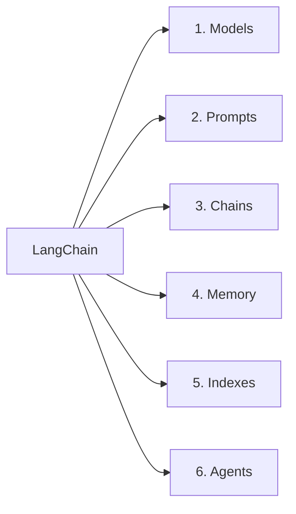
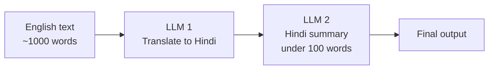
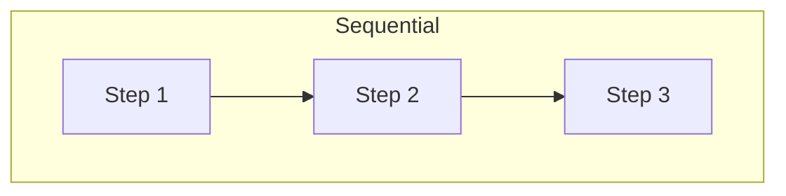
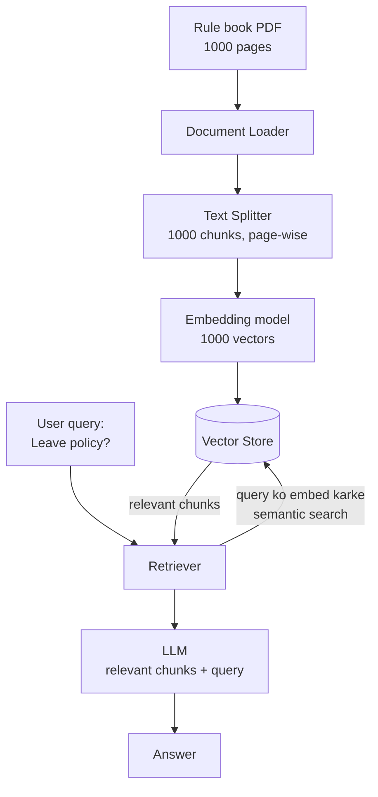
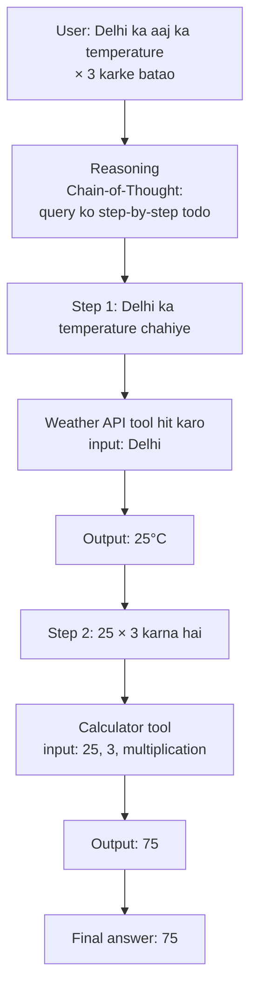

# Video 02— LangChain Components (6 Core Components ka Conceptual Overview)

> 🎥 Video: https://www.youtube.com/watch/-xSJA8-o6Eg
> 📌 Playlist: CampusX (Nitish) — LangChain (playlist ka Video 2)
> 📝 Source: sirf is video ka transcript (author ke PDF notes use nahi hue). Is video mein **koi code nahi**, sirf concepts + industry examples.

---

## 📑 Table of Contents

1. [Video ka goal + Recap](#1-video-ka-goal--recap)
2. [6 Components ka overview](#2-6-components-ka-overview)
3. [Component 1: Models](#3-component-1-models)
4. [Component 2: Prompts](#4-component-2-prompts)
5. [Component 3: Chains](#5-component-3-chains)
6. [Component 4: Indexes](#6-component-4-indexes)
7. [Component 5: Memory](#7-component-5-memory)
8. [Component 6: Agents](#8-component-6-agents)
9. [Roadmap: aage kya aayega](#9-roadmap-aage-kya-aayega)
10. [Key Takeaways](#-key-takeaways)
11. [Self-Test Questions](#-self-test-questions)

---

## 1. Video ka goal + Recap

**Do faayde:**
1. LangChain framework **kaise organized** hai, banane walon ka thought process samajh aata hai
2. Aage ke saare videos isi video ke components pe based honge → **roadmap** milta hai

**Teaching approach:** Pehle **conceptual overview**, phir coding/projects (online resources seedha project banana start kar dete hain, jo sahi tareeka nahi hai). Pehle 2 videos concept ke, uske baad coding.

### Video 1 ka recap

| Topic | Summary |
|---|---|
| LangChain kya hai | **Open-source framework** jisse LLM-powered applications bana sakte ho |
| Zarurat kyun | "PDF se baat karne wala app" ka system design: bahut saare components + unke beech interactions → scratch se coding mein bahut mehnat |
| Sabse bada advantage | Components ke beech efficient **orchestration**, pipeline building, **minimal code mein maximum output** |
| **Chains** | Components ko ek chain mein pirona; ek component ka **output automatically** doosre ka **input** |
| **Model-agnostic** | OpenAI GPT se Google models pe switch karna ho to sirf 1–2 lines change |
| Use cases | Conversational chatbots, AI knowledge assistants, **Agents** |

---

## 2. 6 Components ka overview



> Video mein order: Models → Prompts → Chains → **Indexes** → **Memory** → Agents (diagram mein Memory 4th, Indexes 5th likha tha).

6 components samajh liye to LangChain ka **majority concept** samajh aa jaata hai; poori playlist inhi pe hai.

---

## 3. Component 1: Models

> Definition: Models LangChain ka **core interface** hain jiske through tum AI models se interact karte ho. Sabse important component.

### 🧠 Back story (NLP ki history)

| Stage | Problem / Solution |
|---|---|
| **Chatbot banana** NLP ka sabse popular dream | 2 bade challenges the |
| Challenge 1 | **NLU** (Natural Language Understanding): user ki query samajhna ("Hi, can you check my email") |
| Challenge 2 | **Context-aware text generation**: sahi reply generate karna |
| **LLMs aaye** | Poore internet ke data pe train → dono problems **ek saath solve** |
| Nayi Problem | LLM ka size **100 GB+** (billions of parameters) → normal insaan/chhoti company ke liye chalana mushkil (cloud bill bhi bahut) |
| Solution | Bade companies (OpenAI etc.) ne LLM apne servers pe rakha aur **API** bana di → jitna use utna bill |
| **Teesri Problem** | **Standardization nahi:** har provider ki API alag (code alag, response format alag) |

**Problem ka example:** OpenAI GPT ka code alag, Anthropic Claude Sonnet ka code alag. Ek hi app mein dono use karne ho ya OpenAI se Claude pe switch karna ho → **code base badalna padta hai** (mehnat ka kaam).

### ✅ LangChain ka solution
Models component = **standard interface**. Code mein sirf **package + model class** ki 1–2 lines change (call karne ka tareeka aur result print karne ka tareeka same).

```python
# OpenAI
from langchain_openai import ChatOpenAI
model = ChatOpenAI(model="gpt-4o")

# Claude  (sirf yeh 2 lines change)
from langchain_anthropic import ChatAnthropic
model = ChatAnthropic(model="claude-...")

result = model.invoke("Hello")   # baaki code same
print(result.content)
```
(Video mein 2 code snippets screen pe dikhaye gaye; yeh uska illustration hai.) Response format bhi similar → parse karna easy.

### 2 types ke models

| Type | Input → Output | Use |
|---|---|---|
| **Language Models** (LLMs) | Text → Text | Chatbots, AI agents, "text in, text out" |
| **Embedding Models** | Text → **Vector** | **Semantic search** (pichle video mein discussed) |

### LangChain docs mein kya dekho
- **Chat models** page: providers list — Anthropic, Mistral AI, Azure, OpenAI, Vertex AI, **Bedrock** (AWS), Hugging Face...
- Har model ke saath **features table**: **Tool calling** (agents ke liye), **Structured output**, **JSON mode**, **Local** (apni machine pe chala sakte ho?), **Multimodal input**
- **Embedding models** page: OpenAI, Mistral AI, IBM, Llama...

> ➕ **Extra:** Naye LangChain versions mein `init_chat_model("provider:model-name")` jaisa unified helper bhi hai jisse provider switch aur bhi aasan hota hai (docs check karo apne version ke hisaab se).

---

## 4. Component 2: Prompts

> **Prompt** = LLM ko diya gaya **input** (e.g., ChatGPT mein "What is CampusX").

### Prompts kyun important?
- Output prompts pe **bahut sensitive**: ek word badlo, output kaafi badal jaata hai.
  - "Explain linear regression in **academic tone**" vs "…in **fun tone**" → alag output
- Isi se poora field bana: **Prompt Engineering** (aur "Prompt Engineer" job profile).

LangChain ka Prompts component prompts ko **flexibly aur powerfully** banane deta hai. 3 examples:

### (a) Dynamic & Reusable Prompts
```
Summarize {topic} in {emotion} tone
```
- Placeholders (`{topic}`, `{emotion}`) pehle se fix nahi
- User 1: topic=**cricket**, tone=**fun**; User 2: topic=**biology**, tone=**serious** → **same template** reuse

### (b) Role-based Prompts
- **System-level prompt:** "Hi, you are an experienced **{profession}**"
- **User-level prompt:** "Tell me about **{topic}**"
- User 1: profession=doctor, topic=viral fever; User 2: profession=engineer, topic=developing bridges
- LLM ko **role pe guide** kar rahe ho

### (c) Few-shot Prompts
LLM ko **pehle kuch examples** dikhao, phir naya question poochho.

**Example: Customer support ticket classification**

| Example (ticket) | Category |
|---|---|
| "I was charged twice for my subscription this month" | **Billing issue** |
| "The app crashes every time I try to log in" | **Technical issue** |
| "Can you explain how to upgrade my plan?" | **General inquiry** |

Prompt structure:
```
Classify the following customer support ticket into one of the categories:
Billing issue, Technical issue, General inquiry.

Ticket: <example 1>   Category: <...>
Ticket: <example 2>   Category: <...>
Ticket: <example 3>   Category: <...>
Ticket: <example 4>   Category: <...>

Ticket: <new query>   Category:        ← LLM yahan answer dega
```
Yeh **few-shot prompt template** ban jaata hai.

> Code abhi samajhna zaroori nahi; point yeh hai ki LangChain mein **kitni alag prompting techniques** implement ho sakti hain. (Aage dedicated videos.)

---

## 5. Component 3: Chains

> Chains LangChain ka itna important component hai ki **iske naam pe hi framework ka naam pada** (LangChain).

**Chains = pipelines banane ka tareeka.** Koi bhi LLM application ko pipeline shape de sakte ho.

### Example: English → Hindi summary app
**Requirement:** User ~1000 words ka English text de → output mein **Hindi summary, 100 words se kam**.



| Without Chains | With Chains |
|---|---|
| Har stage ka output **manually** nikal ke agle stage mein daalo | Sirf English text do aur **chain ko call** karo |
| LLM 1 call → translation lo → LLM 2 call → summary lo | Background mein poora task **automatically execute** |

**Chains ki sabse badi khaasiyat:** Pichle stage ka output **automatically** agle stage ka input bana deta hai, **manual code nahi**; "heavy lifting" chain karti hai.

### Chains ke types (sirf sequential nahi)



| Type | Kaise kaam karta hai | Example |
|---|---|---|
| **Sequential chain** | Ek ke baad ek stage | English → Hindi translate → summary |
| **Parallel chain** | Ek hi input **simultaneously** multiple LLMs ko; phir results combine | Input: "911 incident" → **LLM 1** report + **LLM 2** report (parallel) → **LLM 3** dono reports **combine** → final detailed report |
| **Conditional chain** | **Condition** ke basis pe alag processing | User feedback aaya → LLM se check: **acchha** → "Thank you" bol do; **bura** → **customer support team ko email** bhejo |

LangChain bahut **beautifully designed** hai aur tumhara bahut hard work minimize karta hai.

> 🔄 **Update:** Video ke time ke "legacy chain classes" (e.g., `LLMChain`, `SequentialChain`) ab **deprecated** hain. Ab chains ko **LCEL pipe syntax** (`prompt | model | parser`) se banate hain, aur complex/conditional flows ke liye **LangGraph** recommend hota hai. Concept same hai.

---

## 6. Component 4: Indexes

> Indexes = apni **application ko external knowledge** (PDFs, websites, databases) se connect karte hain.

### Problem: ChatGPT private data pe answer nahi de sakta
- Maan lo tum **XYZ company** mein kaam karte ho. ChatGPT se pucha: *"What is the leave policy / notice period policy of XYZ?"* → **Answer nahi de paayega**, kyunki yeh **private company data** hai jo training mein nahi dekha.
- General question ("Who is the PM of India") → LLM answer de dega (training mein hai).
- **Solution:** LLM ko **external knowledge source** (company ki rule book) se connect karo.

### Indexes ke 4 sub-components

| # | Component | Kaam |
|---|---|---|
| 1 | **Document Loader** | Data kahin se bhi (cloud, Google Drive etc.) **load** karna (PDF, website, DB) |
| 2 | **Text Splitter** | Bade document ko **chhote chunks** mein todna (pages / paragraphs / chapters ke basis pe) |
| 3 | **Vector Store** (Vector Database) | Chunks ke **embeddings (vectors) store** karna, taaki kabhi bhi search ho sake |
| 4 | **Retriever** | User query ko **embed** karke vector store mein **semantic search** karna, relevant chunks nikalna |

### Poora flow (1000-page rule book example)



1. PDF load → 2. page-wise **1000 chunks** → 3. har chunk ka **embedding** (1000 vectors) → 4. **Vector DB** mein store (search aaj, parson, 10 din baad — kabhi bhi)
5. Query aaye → **Retriever** query ka embedding → semantic search → relevant results
6. Relevant results + user query → **LLM** → reply

External knowledge source kuch bhi ho sakta hai (PDF, website, company database) — flexible.

> ➕ **Extra:** Yeh poora pattern **RAG (Retrieval-Augmented Generation)** kehlata hai.
>
> 🔄 **Update:** Naye LangChain docs mein is area ko zyada **"Retrieval"** ke naam se organize kiya jaata hai (document loaders, text splitters, vector stores, retrievers), "Indexes" term kam dikhta hai; concept same hai.

---

## 7. Component 5: Memory

### Problem: LLM API calls **stateless** hain
**Stateless** = har request **independent**; previous request ki koi memory nahi.

**Example (OpenAI API):**
1. Query: *"Who is Narendra Modi"* → proper jawab ("Indian politician, current PM...")
2. Query badal ke: *"How old is he"* → *"As an AI I don't have access to personal data..."*
   → Model ko "**he**" decode hi nahi hua, kyunki pichla question yaad nahi.

Chatbot ke saath yeh **bahut frustrating** hoga (har baar context yaad dilana padega). **Memory component** yahi solve karta hai.

### Memory ke types

| Type | Kaise kaam karta hai | Trade-off |
|---|---|---|
| **Conversation Buffer Memory** | Ab tak ki **poori chat history** store, har next API call mein bhejo | Chat lambi → history badi → **zyada text process, zyada paisa** |
| **Conversation Buffer Window Memory** | Sirf **last N interactions** (e.g., last 100 messages) store/send; constantly update | Purani baatein bhool jaata hai |
| **Summarizer-based Memory** | Ab tak ki poori chat history ka **summary** banake bhejo | Text kam → **cost kam** |
| **Custom Memory** | Advanced use cases: specialized info (user ki **preferences**, facts & figures) hamesha memory mein | Conversation easy ho jaati hai |

> ➕ **Extra:** Memory ka core idea = **pichli baatein har naye API call ke saath context ke roop mein bhejna**. Isi liye lambi conversations mein cost aur context-window limit ka dhyan rakhna padta hai.
>
> 🔄 **Update:** `ConversationBufferMemory` jaise classic memory classes ab **legacy** hain. Naye LangChain mein chat history / persistence **LangGraph (checkpointers)** ya message-history wrappers se handle hoti hai.

---

## 8. Component 6: Agents

### Chatbot → AI Agent
- LLMs ki 2 khoobiyan: **NLU** + **text generation** → sabse pehla use case **chatbot** (jaise ChatGPT khud ek chatbot hai).
- Phir socha: agar chatbot meri baat samajh ke reply kar sakta hai to **kaam bhi** to kar sakta hai.

### Example: MakeMyTrip (travel website)

| Chatbot | AI Agent |
|---|---|
| "Summer mein India mein best destination?" → LLM ke knowledge se: *Shimla, Manali* | Yahi answer + **kaam bhi** |
| Bas baat kar sakta hai | "24 January ko Delhi–Shimla **cheapest flight** kaun si?" → **API hit** karke result: *IndiGo...* |
| | "**Book** the flight" → MakeMyTrip pe **booking** bhi kar dega |

> **AI Agent = Chatbot with super powers** (baat bhi, kaam bhi).

### Agent ke paas 2 cheezein jo chatbot ke paas nahi
1. **Reasoning capability**
2. **Tools ka access**

### Example flow: *"Multiply today's temperature of Delhi by 3"*
Tools: **Calculator** (kisi bhi math ke liye) + **Weather API** (kisi bhi city/date ka weather)



- Reasoning ek technique se hoti hai, jaise **Chain of Thought** (query ko step-by-step break down karna)
- Agent har step pe **check** karta hai: "kya mere paas aisa tool hai?" → sahi tool call karta hai

**Summary:** Agent aur chatbot mein bas itna farak: agent ke paas **reasoning + tools**. Agent = **evolved form of chatbot** jo **actions** perform kar sakta hai.

Sabhi badi companies/researchers is topic pe converge ho rahe hain; LangChain ne agents banana bahut aasan kar diya hai (aage ek agent banake dikhaya jayega).

> 🔄 **Update:** Naye LangChain versions mein agents ka recommended base **LangGraph** hai, aur "reasoning + tool calling" ke liye **ReAct-style** agent pattern common hai. Models ka "Tool calling" feature (Section 3 mein docs table wala) agents ke liye isi wajah se important hai.

---

## 9. Roadmap: aage kya aayega
- **Next video:** pehla component **Models** — detail mein (aur uske baad ek-ek karke Prompts, Chains, Indexes, Memory, Agents).
- Poori playlist inhi 6 components ke around hai.

---

## ✅ Key Takeaways

1. LangChain mein **6 components**: **Models, Prompts, Chains, Indexes, Memory, Agents**.
2. **Models:** AI models se baat karne ka **standard interface** → provider switch karne ke liye sirf 1–2 lines change. 2 types: **Language** (text→text) aur **Embedding** (text→vector).
3. **Prompts:** LLM output prompt pe bahut sensitive. LangChain: **dynamic/reusable**, **role-based**, **few-shot** prompts.
4. **Chains:** pipelines; ek stage ka output **auto** agle ka input. Types: **sequential, parallel, conditional**. (Isi se framework ka naam.)
5. **Indexes:** LLM ko **external knowledge** se jodna. 4 parts: **Document Loader → Text Splitter → Vector Store → Retriever**.
6. **Memory:** LLM API calls **stateless** hote hain; memory conversation context deta hai. Types: buffer, buffer window, summarizer-based, custom.
7. **Agents:** chatbot + **reasoning** + **tools** = baat bhi, kaam bhi.
8. Pehle **concepts**, phir coding → isi liye yeh video bina code ka hai.

---

## 🧪 Self-Test Questions

1. LangChain ke 6 components kaun se hain?
2. LLMs aane ke baad kaun si 2 NLP problems solve hui, aur kaun si nayi problems aayi?
3. Alag-alag LLM APIs ke saath kaam karna kyun mushkil tha? LangChain ka Models component ise kaise solve karta hai?
4. Language models aur Embedding models mein kya difference hai?
5. LangChain docs ke chat models page pe model-wise kaun se features dekhne chahiye?
6. Prompt engineering kyun ek alag field ban gaya?
7. Dynamic, role-based aur few-shot prompts ko ek-ek example se samjhao.
8. Chain kya hai? English→Hindi summary example ko chain ke saath aur bina chain ke compare karo.
9. Sequential, parallel aur conditional chains mein difference batao (ek-ek example).
10. ChatGPT company ki leave policy ka jawab kyun nahi de sakta? Iska solution kya hai?
11. Indexes ke 4 sub-components aur unka kaam batao.
12. 1000-page rule book wale example ka poora flow (load se answer tak) explain karo.
13. "LLM API calls stateless hote hain" ka matlab ek example se samjhao.
14. Memory ke 4 types aur har ek ka trade-off kya hai?
15. Chatbot aur AI Agent mein asli difference kya hai? "Delhi temperature × 3" example ka flow explain karo.