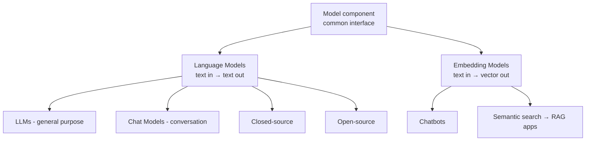
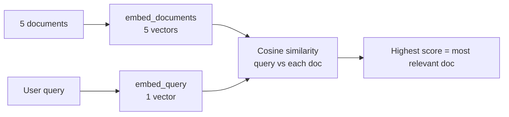

# Video 3 — Models in LangChain (Language Models + Embedding Models)

> 🎥 Video: https://www.youtube.com/watch/HdcLE8JuMrA
> 📌 Playlist: CampusX (Nitish) — LangChain
> 📝 Source: sirf is video ka transcript (author ke PDF notes use nahi hue).

---

## 📑 Table of Contents

1. [Recap + Model component kya hai?](#1-recap--model-component-kya-hai)
2. [Plan of Action](#2-plan-of-action)
3. [Language Models: LLM vs Chat Model](#3-language-models-llm-vs-chat-model)
4. [Setup (venv, requirements, folders)](#4-setup-venv-requirements-folders)
5. [Closed-source LLM (OpenAI) demo](#5-closed-source-llm-openai-demo)
6. [Chat Models: OpenAI (+ temperature, max tokens)](#6-chat-models-openai--temperature-max-tokens)
7. [Chat Models: Anthropic (Claude)](#7-chat-models-anthropic-claude)
8. [Chat Models: Google (Gemini)](#8-chat-models-google-gemini)
9. [Open-source models: kya, kyun, kahan](#9-open-source-models-kya-kyun-kahan)
10. [Open-source via Hugging Face Inference API](#10-open-source-via-hugging-face-inference-api)
11. [Open-source locally (download + run)](#11-open-source-locally-download--run)
12. [Embedding Models](#12-embedding-models)
13. [Document Similarity App (mini semantic search)](#13-document-similarity-app-mini-semantic-search)
14. [Key Takeaways](#-key-takeaways)
15. [Self-Test Questions](#-self-test-questions)

---

## 1. Recap + Model component kya hai?

**Pichle videos:** (1) LangChain intro, kyun zaroori, kya bana sakte ho, alternatives; (2) LangChain ke components (Models, Prompts, Agents, Chains...) + real-life examples. **Aaj:** pehla component **Models**, end-to-end, coding ke saath.

**Problem:** Alag-alag companies ke AI models alag tareeke se behave karte hain (alag API/format).

**Solution:** LangChain ka **Model component** = ek **common interface** jo alag-alag AI models se connect hone deta hai.



| Model type | Input → Output | Use |
|---|---|---|
| **Language model** | Text → Text | Chatbots jaisi applications |
| **Embedding model** | Text → **Vector** (series of numbers) | **Semantic search** → **RAG-based** applications (e.g., apne document pe chat) |

> Embedding = numbers ka vector jo text ka **context** represent karta hai.

---

## 2. Plan of Action

1. **Language models:** LLMs (sirf OpenAI) → Chat models (**OpenAI, Anthropic Claude, Google Gemini**) → **Open-source** (Hugging Face: API + local)
2. **Embedding models:** OpenAI (closed) → Hugging Face (open-source, local)
3. **Mini app:** Document Similarity (semantic search)

---

## 3. Language Models: LLM vs Chat Model

| Feature | **LLM** | **Chat Model** |
|---|---|---|
| Purpose | **Free-form text generation** (QA, summarization, translation, code gen) | **Multi-turn conversation** (user ↔ AI) |
| Input → Output | **String → String** (plain text) | **Sequence of messages → chat messages** |
| Training | General text (books, articles, Wikipedia) | LLM-jaisi training **+ fine-tuning on chat/conversation datasets** |
| Memory / conversation history | ❌ Nahi (pichli baat yaad nahi) | ✅ Conversation history support |
| Role awareness | ❌ Roles assign nahi kar sakte | ✅ System role de sakte ho ("You are a very knowledgeable doctor...") — model ko pata hota hai wo kaun hai, user kaun hai, AI kaun hai |
| Best for | Text generation, summarizer, translation, code generation | Chatbots, virtual assistants, customer support bots, AI tutors, agents, coding assistants |
| LangChain mein status | **Legacy** — support dheere-dheere khatam, naye projects ke liye recommend nahi | **Recommended / focus** |

**Industry trend:** Gen-AI industry chat models ki taraf shift ho rahi hai. LLM abhi bhi use kar sakte ho, par naye code mein **chat models** use karo. Video mein pehle LLM demo (halka), phir poora focus chat models pe.

> ➕ **Extra:** LangChain mein code level pe fark: LLM classes `BaseLLM` se inherit karti hain, chat model classes `BaseChatModel` se (video mein `OpenAI` vs `ChatOpenAI` ka source code dikhaya gaya).

---

## 4. Setup (venv, requirements, folders)

```bash
mkdir langchain-models && cd langchain-models      # folder (VS Code mein open karo)
python -m venv venv                                # virtual environment
venv\Scripts\activate                              # Windows (Linux/Mac: source venv/bin/activate)
pip install -r requirements.txt
```

**`requirements.txt`** (video mein ek list di gayi thi; typical packages ye hote hain):
```
langchain
langchain-core
langchain-community
langchain-openai
langchain-anthropic
langchain-google-genai
langchain-huggingface
huggingface-hub
transformers
torch
sentence-transformers
scikit-learn
numpy
python-dotenv
```
> ➕ **Extra:** Exact list video ke screen pe thi (transcript mein nahi); upar wali list is video ke code ke hisaab se zaroori packages hain.

**Test:**
```python
import langchain
print(langchain.__version__)
```

**3 folders:** `llms/`, `chat_models/`, `embedded_models/` — in mein saara kaam.

---

## 5. Closed-source LLM (OpenAI) demo

### API key setup
1. `platform.openai.com` pe account banao
2. **Minimum $5 credit** recharge karna padta hai (ab free credits nahi milte; $5 kaafi hain)
3. Settings → API keys → **Create secret key**
4. Project mein **`.env`** file banao:
```
OPENAI_API_KEY="your-key-here"
```
Variable ka naam **exactly** yahi rakhna (`OPENAI_API_KEY`), warna `load_dotenv()` nahi dhoondh paayega.

> ➕ **Extra:** `.env` ko `.gitignore` mein daalo, key kabhi GitHub pe push mat karo. (Speaker bhi video ke baad key delete karne wale the.)

### Code (`llms/llm_demo.py`)
```python
from langchain_openai import OpenAI
from dotenv import load_dotenv

load_dotenv()

llm = OpenAI(model='gpt-3.5-turbo-instruct')   # video mein 3.5-turbo-instruct

result = llm.invoke("What is the capital of India")
print(result)       # plain string: "The capital of India is New Delhi."
```

| Cheez | Matlab |
|---|---|
| `langchain-openai` | LangChain ↔ OpenAI integration package |
| `load_dotenv()` | `.env` se secret keys load karta hai |
| **`invoke()`** | Core LangChain method (models, prompts, chains — sab mein hota hai; reason aage **Runnable interface** mein) |

**Observation:** LLM ko **string** bheji, **string** hi wapas aayi → confirm ki yeh LLM hai.

---

## 6. Chat Models: OpenAI (+ temperature, max tokens)

LangChain ka interface **consistent** hai — code mein bahut kam change:

```python
from langchain_openai import ChatOpenAI      # OpenAI ki jagah ChatOpenAI
from dotenv import load_dotenv

load_dotenv()

model = ChatOpenAI(model='gpt-4')            # variable ka naam ab `model`
result = model.invoke("What is the capital of India")

print(result)            # poora object (content + metadata)
print(result.content)    # sirf answer
```

**Result string nahi, ek message object hota hai:** `content` (answer) + additional kwargs / **metadata** (completion tokens, prompt tokens, total tokens, etc.). Sirf answer chahiye to `result.content`.

> Video mein available OpenAI models + **context window** + **max output tokens** OpenAI website ke Models section pe dikhaye gaye; unke hisaab se model choose karo.

### Important parameters

#### 1) `temperature` — creativity control
```python
model = ChatOpenAI(model='gpt-4', temperature=1.5)
```

| Range (video ke hisaab se) | Behaviour | Kab use |
|---|---|---|
| **0 – 0.3** | Deterministic, predictable | Factual answers, maths, **code** |
| **0.5 – 0.7** | Balanced | General Q&A, explanations |
| **0.9 – 1.2** | Creative | Story-telling, jokes, writing |
| **1.5+** | Bahut random/diverse | Brainstorming |

Demo: "Suggest 5 Indian male names" (temp 0 vs 1.8 — bahut fark nahi dikha), "Write a 5 line poem on cricket" (1.5 pe zyada random).

#### 2) `max_completion_tokens` — output length limit
```python
model = ChatOpenAI(model='gpt-4', temperature=1.5, max_completion_tokens=10)
```
- Output mein **max kitne tokens** chahiye. 10 diya to sirf 10 tokens aaye.
- **Kyun zaroori:** Paid models **per-token** charge karte hain (pricing "per million tokens"). Limit lagake cost control.
- Token ≈ word (roughly), par exactly word nahi (tokenization alag topic).

> ⚠️ **Correction / Extra:** Temperature ki "0 se 2" range **OpenAI** ki hai; doosre providers mein alag ho sakti hai (e.g., Anthropic 0–1). Aur kuch naye reasoning models temperature set karne nahi dete. Provider docs check karo.

---

## 7. Chat Models: Anthropic (Claude)

Claude ek popular model hai; kai benchmarks mein GPT se behtar bataya jaata hai. Company: **Anthropic**.

**Setup:** Anthropic Console → top-up credits (paid) → **Get API keys** → Create key.
`.env` mein exact naam:
```
ANTHROPIC_API_KEY="..."
```
(Naam change kiya to `load_dotenv()` key locate nahi karega.)

```python
from langchain_anthropic import ChatAnthropic
from dotenv import load_dotenv

load_dotenv()

model = ChatAnthropic(model='claude-3-5-sonnet-20241022')   # video ke time ka latest model: Claude 3.5
result = model.invoke("What is the capital of India")
print(result.content)
```
Same structure, bas class (`ChatAnthropic`) aur key alag. `temperature`, `max_tokens` yahan bhi set kar sakte ho.

> 🔄 **Update:** Video ke time (Claude 3.5) ke baad Claude ke naye generations aa chuke hain. Model naam copy karne se pehle Anthropic ke **models docs** se current model string dekho.

---

## 8. Chat Models: Google (Gemini)

**Setup:** Google AI Studio → **Get Gemini API key** → create key. `.env`:
```
GOOGLE_API_KEY="..."
```

```python
from langchain_google_genai import ChatGoogleGenerativeAI
from dotenv import load_dotenv

load_dotenv()

model = ChatGoogleGenerativeAI(model='gemini-1.5-pro')
result = model.invoke("What is the capital of India")
print(result.content)
```

**3 closed-source models ka summary:** OpenAI GPT, Anthropic Claude, Google Gemini — teeno ke saath **same code pattern** → yahi LangChain ki power hai.

> 🔄 **Update:** Gemini 1.5 purana generation hai; naye Gemini versions aa chuke hain. Current model naam Google ke docs se verify karo.

---

## 9. Open-source models: kya, kyun, kahan

**Closed-source (GPT, Claude, Gemini):** Model company ke server pe, **API** ke through access. Do flaws: (1) **paise** dene padte hain, (2) **control nahi** (model change nahi kar sakte).

**Open-source:** Company/org model train karke **freely release** karti hai → tum **download, modify, fine-tune, deploy** kar sakte ho bina restriction ke.

| Factor | Open-source | Closed-source |
|---|---|---|
| **Cost** | Free; locally chalao (API fee nahi) | API use ke paise |
| **Control** | Fine-tune/modify/jahan chahe deploy | Sirf provider ka infra; **zero control** |
| **Data privacy** | Data apni machine pe → **confidential documents** ke saath bhi safe | Data provider ke servers pe bhejna padta hai |
| **Customization** | Apne datasets pe fine-tune | Limited (kuch providers dete hain) |
| **Deployment** | Apne server/cloud pe | Aisa option nahi |

**Famous open-source language models:** **Llama** (Meta), **Mistral**, **Falcon**, **BLOOM** (domain-specific). Hugging Face pe aur bhi dikhte hain: **DeepSeek, Qwen** (China).

**Kahan milenge?** → **Hugging Face** (open-source models ki sabse badi repository; thousands of models: text generation, multimodal, computer vision, NLP...).

**2 tareeke use karne ke:**
1. **Local download** (sabse popular): model apni machine pe download karke chalao
2. **Hugging Face Inference API:** HF ke server pe model, API se call (free tier limit tak free, uske baad paid)

### ❌ Disadvantages
| Issue | Detail |
|---|---|
| **Hardware** | Solid hardware chahiye; bade models ke liye expensive **GPU** |
| **Setup complexity** | Chizein prepare karni padti hain (hectic) |
| **Kam refinement** | **RLHF** (human feedback pe fine-tuning) kam hoti hai → responses closed models se thode kam refined |
| **Limited multimodal** | Abhi mostly text-heavy; image/audio models kam |

---

## 10. Open-source via Hugging Face Inference API

**Setup:** HF account → **Access Tokens** → Create new token (type **Read**, naam e.g. `langchain-token`). `.env` mein save karo.

> ⚠️ **Correction:** Transcript mein variable naam `HUGGINGFACEHUB_ACCESS_TOKEN` jaisa bola gaya; `huggingface_hub` / LangChain ke liye standard naam **`HUGGINGFACEHUB_API_TOKEN`** (ya `HF_TOKEN`) hai. Agar auth error aaye to yeh naam use karo.

**Model:** `TinyLlama/TinyLlama-1.1B-Chat-v1.0` — chhota model (**1.1B parameters**), Llama pe fine-tuned.

```python
from langchain_huggingface import ChatHuggingFace, HuggingFaceEndpoint
from dotenv import load_dotenv

load_dotenv()

llm = HuggingFaceEndpoint(
    repo_id="TinyLlama/TinyLlama-1.1B-Chat-v1.0",
    task="text-generation"
)

model = ChatHuggingFace(llm=llm)
result = model.invoke("What is the capital of India")
print(result.content)
```

- `repo_id` = HF pe model ka path; `task` = kaunsa kaam (text-generation)
- Model **HF ke server pe** hai, local download nahi hua

> 🔄 **Update:** HF ki serverless Inference API ab **Inference Providers** ke naam se kaam karti hai aur free limits tight ho sakti hain; ye pattern chale na to HF docs dekho.

---

## 11. Open-source locally (download + run)

```python
from langchain_huggingface import ChatHuggingFace, HuggingFacePipeline
import os

os.environ['HF_HOME'] = 'D:/huggingface_cache'     # optional: download location badalna

llm = HuggingFacePipeline.from_model_id(
    model_id='TinyLlama/TinyLlama-1.1B-Chat-v1.0',
    task='text-generation',
    pipeline_kwargs=dict(
        temperature=0.5,
        max_new_tokens=100
    )
)

model = ChatHuggingFace(llm=llm)
result = model.invoke("What is the capital of India")
print(result.content)
```

| Cheez | Detail |
|---|---|
| API ke bajaye | `HuggingFaceEndpoint` → **`HuggingFacePipeline`** |
| `from_model_id` | Model + tokenizer + config files **local download** |
| `pipeline_kwargs` | `temperature`, `max_new_tokens` (yahin set hote hain) |
| `HF_HOME` | Default cache C drive; speaker ke C drive mein jagah nahi thi to D drive set kiya (zaroori nahi aapko) |
| **First run** | Download hota hai; **dobara chalane pe cache** se load (download nahi) |
| Speed | GPU ho to fast, CPU pe slow. Speaker ki 8GB RAM machine pe ~10 min, system hang hua |

> ⚠️ **Correction:** Speaker ko download size yaad nahi tha (guess "300–500 MB"). TinyLlama-1.1B ke weights roughly **~2 GB+** hote hain (1.1B params × 2 bytes ≈ 2.2 GB, fp16). Disk space aur RAM accordingly rakho.

Output mein user ka question + assistant ka answer dono formatted dikhte hain (chat template ki wajah se).

---

## 12. Embedding Models

**Kaam:** text → **vector** (context capture karta hai). Chat/LLM ki tarah text nahi, numbers return karte hain.

### OpenAI embeddings

```python
from langchain_openai import OpenAIEmbeddings
from dotenv import load_dotenv

load_dotenv()

embedding = OpenAIEmbeddings(model='text-embedding-3-large', dimensions=32)

# Single text
vector = embedding.embed_query("Delhi is the capital of India")
print(str(vector))                 # 32-dimension vector

# Multiple documents
documents = [
    "Delhi is the capital of India",
    "Kolkata is the capital of West Bengal",
    "Paris is the capital of France"
]
vectors = embedding.embed_documents(documents)
print(str(vectors))                # 2D list: har document ka ek vector
```

| Method | Use |
|---|---|
| `embed_query(text)` | **Ek** text/query ka vector |
| `embed_documents(list)` | **Multiple** documents ek saath → list of vectors |

**`dimensions`:**
- Bada vector → zyada contextual meaning capture; chhota vector → kam
- **Default:** `text-embedding-3-small` = **1536**, `text-embedding-3-large` = **3072** dimensions
- Speaker ke hisaab se chhota vector = kam cost

> ⚠️ **Correction:** OpenAI embeddings ki billing **input tokens** pe hoti hai, `dimensions` pe nahi. Chhote vector se asli bachat **storage + similarity-search compute** mein hoti hai, API price mein nahi. Aur `dimensions` parameter sirf **`text-embedding-3-*`** models pe kaam karta hai.

**Cost:** Embeddings bahut sasti hain (per million tokens bahut kam). Speaker ke experience mein OpenAI embeddings free wale se zyada accurate/better context dete hain.

### Open-source embeddings (Hugging Face, local)

Model: `sentence-transformers/all-MiniLM-L6-v2` — text ko **384-dimension** dense vector mein map karta hai (clustering, semantic search ke liye); ~**90 MB**, chhota model.

```python
from langchain_huggingface import HuggingFaceEmbeddings

embedding = HuggingFaceEmbeddings(model_name='sentence-transformers/all-MiniLM-L6-v2')

vector = embedding.embed_query("Delhi is the capital of India")
print(str(vector))

vectors = embedding.embed_documents(["Delhi is the capital of India",
                                     "Kolkata is the capital of West Bengal",
                                     "Paris is the capital of France"])
print(str(vectors))      # 3 vectors x 384 dimensions
```
- First run pe model + tokenizer download; dobara cache se
- Same methods (`embed_query`, `embed_documents`) — **consistent interface**

---

## 13. Document Similarity App (mini semantic search)

**Idea:** 5 documents (har ek cricketer ke baare mein) + user ka query → batao kaunsa document sabse relevant hai.



```python
from langchain_openai import OpenAIEmbeddings
from dotenv import load_dotenv
from sklearn.metrics.pairwise import cosine_similarity
import numpy as np

load_dotenv()

embedding = OpenAIEmbeddings(model='text-embedding-3-large', dimensions=300)

documents = [
    "Virat Kohli is an Indian cricketer known for his aggressive batting ...",
    "...",   # baaki 4 cricketers ke descriptions
]

query = "Tell me about Bumrah"

doc_embeddings = embedding.embed_documents(documents)    # 5 vectors
query_embedding = embedding.embed_query(query)           # 1 vector

scores = cosine_similarity([query_embedding], doc_embeddings)[0]   # 2D input, 2D output -> [0] se flat list

index, score = sorted(list(enumerate(scores)), key=lambda x: x[1])[-1]

print(query)
print(documents[index])
print("similarity score is:", score)
```

**Steps / learning:**
1. Documents ke embeddings nikalo (5 vectors, 300 dim)
2. Query ka embedding nikalo (1 vector)
3. `cosine_similarity` — **dono inputs 2D list** hone chahiye
4. Result bhi 2D → `[0]` se simple list
5. `enumerate(scores)` se har score ke saath **index** attach → sort karne ke baad bhi **position** yaad rahe
6. Score (x[1]) pe sort → last element = **highest score** → `documents[index]` = relevant document

**Demo:** "Tell me about Virat Kohli" → document 0, score ≈ **0.66** (doosre ≈ 0.34...). "Tell me about Bumrah" → Bumrah wala document.

> ➕ **Extra:** Sorting ki jagah seedha `idx = np.argmax(scores)` bhi chalega.

### Limitation → Vector Database
Is app mein **document embeddings har run pe dobara** generate hote hain (costly). Better: documents ke embeddings **ek baar** nikal ke **Vector Database** mein store karo; naya query aaye to sirf query ka embedding nikalo aur similarity (**retrieval**) chalao. Yahi RAG-based applications ka core idea hai (aage ke videos).

---

## ✅ Key Takeaways

1. LangChain ka **Model component** = alag-alag AI models ke liye **common interface**.
2. **2 types:** Language models (text→text) aur Embedding models (text→vector).
3. Language models: **LLM** (string→string, legacy) vs **Chat Model** (messages, history, roles, **recommended**).
4. **`invoke()`** LangChain ka core method hai; LLM string return karta hai, chat model **message object** (`.content` se answer).
5. Closed-source: **OpenAI (ChatOpenAI), Anthropic (ChatAnthropic), Google (ChatGoogleGenerativeAI)** — same code structure, bas class + API key alag.
6. API keys `.env` mein, **exact variable names** ke saath; `load_dotenv()` se load. Key kabhi share mat karo.
7. **`temperature`** (creativity) aur **`max_completion_tokens`** (output limit/cost control) important parameters.
8. **Open-source** (Llama, Mistral...) = free, full control, data privacy, fine-tuning; **cons:** hardware, setup, kam refinement, limited multimodal.
9. HF se 2 tareeke: **Inference API (`HuggingFaceEndpoint`)** ya **local (`HuggingFacePipeline`)**; local pe first run pe download, baad mein cache.
10. **Embedding models:** `embed_query` (ek text), `embed_documents` (multiple). Dimensions jitne zyada → zyada context.
11. **Cosine similarity** se query ke sabse relevant document ka **semantic search**; scale pe embeddings **vector database** mein store hote hain.

---

## 🧪 Self-Test Questions

1. LangChain ka Model component kis problem ko solve karta hai?
2. Language model aur Embedding model mein input/output ka kya difference hai? Har ek ka use case batao.
3. LLM aur Chat Model mein 5 differences likho. Naye projects mein kya recommend hota hai?
4. `.env` mein API key ka variable naam exact kyun rakhna padta hai?
5. `OpenAI` aur `ChatOpenAI` ke output mein kya difference hai? Sirf answer kaise nikaloge?
6. `temperature` kya hai? Code generation aur story-writing ke liye kya values rakhoge?
7. `max_completion_tokens` kyun use karte hain?
8. Closed-source vs Open-source models ke 5 factors pe comparison karo.
9. Open-source models ke 4 disadvantages batao.
10. `HuggingFaceEndpoint` aur `HuggingFacePipeline` mein kya difference hai?
11. Local run ke first aur second run mein kya difference hota hai (cache)?
12. `embed_query` aur `embed_documents` mein kya difference hai? Output ka shape kya hota hai?
13. Embedding `dimensions` badhane/ghatane ka kya effect hota hai? (billing ke baare mein sahi baat kya hai?)
14. Cosine similarity ke liye input 2D list kyun chahiye?
15. Document similarity app mein `enumerate` kyun use kiya?
16. Embeddings ko vector database mein kyun store karte hain?