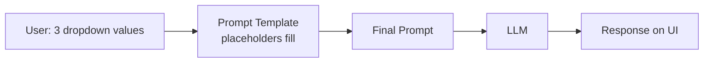
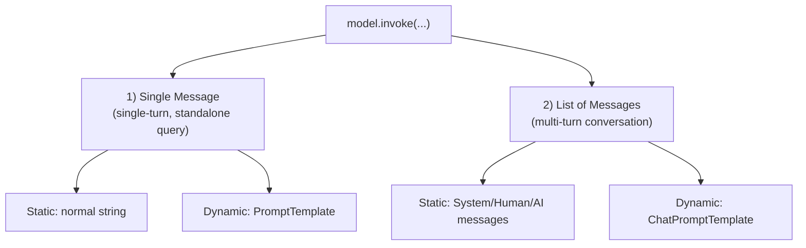

# Video 05 — Prompts in LangChain

> 🎥 Video: https://www.youtube.com/watch/3TGqlQxpuU0
> 📌 Playlist: CampusX (Nitish) — LangChain
> 📝 Source: sirf is video ka transcript (author ke PDF notes use nahi hue).

---

## 📑 Table of Contents

1. [Recap + Plan](#1-recap--plan)
2. [Temperature — speaker ka correction](#2-temperature--speaker-ka-correction)
3. [Prompt kya hota hai?](#3-prompt-kya-hota-hai)
4. [Static vs Dynamic Prompts (Research Tool demo)](#4-static-vs-dynamic-prompts-research-tool-demo)
5. [`PromptTemplate`](#5-prompttemplate)
6. [PromptTemplate kyun? (f-string se better — 3 reasons)](#6-prompttemplate-kyun-f-string-se-better--3-reasons)
7. [Simple Chatbot + Chat History](#7-simple-chatbot--chat-history)
8. [Message Types: System / Human / AI](#8-message-types-system--human--ai)
9. [Recap diagram: `invoke` ko kya bhej sakte ho](#9-recap-diagram-invoke-ko-kya-bhej-sakte-ho)
10. [`ChatPromptTemplate`](#10-chatprompttemplate)
11. [`MessagesPlaceholder`](#11-messagesplaceholder)
12. [Key Takeaways](#-key-takeaways)
13. [Self-Test Questions](#-self-test-questions)

---

## 1. Recap + Plan

| Video | Topic |
|---|---|
| 1 | LangChain intro, framework ki zarurat kyun |
| 2 | LangChain ke 6 main components + real-life example |
| 3 | **Models** component (deep dive) |
| **4 (aaj)** | **Prompts** component |

**Aaj ka plan:** Prompts end-to-end, important classes aur kab kaunsi use karni hai.

---

## 2. Temperature — speaker ka correction

Pichle video (Models) mein temperature ka explanation incomplete tha (ek student ne comment mein point out kiya).

| Temperature | Behaviour |
|---|---|
| **0 ke aaspaas** | Same input → **same output** har baar (deterministic) |
| **~1.5 ke aaspaas** | Same input → har baar **alag / creative** output |

**Demo:** Same prompt (*"Write a 5 line poem on cricket"*) GPT-4 ko:
- `temperature=0` → dobara run karne pe bhi exactly same poem
- `temperature=0.5` → thoda sa change
- `temperature=1.5` → kaafi different, creative output

**Rule of thumb:**
- Same input pe same output chahiye (e.g., factual apps) → temperature ≈ 0
- Har baar alag output chahiye (creative apps) → temperature ≈ 1.5

> ⚠️ **Correction / Extra:** "0 se 2" range **OpenAI models** ki hai; har provider ki range alag ho sakti hai (e.g., Anthropic mein 0–1). Aur temperature 0 pe bhi output **100% guaranteed identical nahi** hota (kuch models mein thoda variation reh sakta hai). Provider docs check karo.

---

## 3. Prompt kya hota hai?

- LLM ko jo **message** bhejte ho, wahi **prompt** hai. (Pichle video mein bhi prompts hi use kiye the, bas "prompt" word use nahi kiya tha.)
- Prompts **text-based** ya **multimodal** ho sakte hain:

| Type | Example |
|---|---|
| Text | Normal chat message |
| Image | Image upload karke questions pochna |
| Sound | Gaana upload karke singer pochna |
| Video | Video upload karke question |

- **Aaj ka focus: text-based prompts** (99% time yahi use hote hain).
- **Prompts bahut sensitive hote hain:** thoda sa change → output kaafi change. Isi liye **Prompt Engineering** naam ka poora job profile ban gaya hai.

---

## 4. Static vs Dynamic Prompts (Research Tool demo)

### Galat tareeka (jo ab tak kiya)
```python
model.invoke("Write a 5 line poem on cricket")   # prompt programmer ne hardcode kiya
```
Real app mein **programmer prompt nahi likhta** — **user** likhta hai.

### Demo app: Research Assistant (Streamlit UI)
Flow: User text box mein prompt likhta hai → **Summarize** button → prompt LLM ko → response UI pe.

```python
from langchain_openai import ChatOpenAI
from dotenv import load_dotenv
import streamlit as st

load_dotenv()
model = ChatOpenAI()

st.header('Research Tool')
user_input = st.text_input('Enter your prompt')

if st.button('Summarize'):
    result = model.invoke(user_input)
    st.write(result.content)
```
Run: `streamlit run prompt_ui.py` (install: `pip install streamlit`)

### 🔴 Static Prompt
User **poora prompt khud** likhta hai (e.g., "Summarize Attention Is All You Need in simple fashion"). Har naye paper ke liye naya prompt.

**Problems:**

| Problem | Detail |
|---|---|
| Output prompt pe bahut depend karta hai | Thoda sa change ("5 lines" ki jagah "math heavy"/"code heavy") → output kaafi alag |
| User ko paper ka exact naam nahi pata | Galat naam → LLM **hallucinate** kar sakta hai |
| **Inconsistent user experience** | Tool ki khaasiyat (e.g., achhi analogy, examples) guarantee nahi kar sakte |

→ Static prompts real apps mein **zyada use nahi hote** (user ko bahut zyada control mil jaata hai).

### 🟢 Dynamic Prompt
Developer pehle se **template** banata hai, user se sirf **values** leta hai.

**UI changes:** 1 text box ki jagah **3 dropdowns** (`st.selectbox`):

| Dropdown | Options (demo) |
|---|---|
| Paper | Attention Is All You Need, Word2Vec (BERT, GPT-3 etc. — 4-5 options) |
| Explanation style | Simple/intuitive, Math-heavy, Code-heavy |
| Explanation length | Short, Medium, Long |

**Benefits:** spelling mistake ka scope nahi, consistent output, developer ka control.



---

## 5. `PromptTemplate`

```python
from langchain_core.prompts import PromptTemplate

template = PromptTemplate(
    template="""
Please summarize the research paper titled "{paper_input}" with the following specifications:
Explanation Style: {style_input}
Explanation Length: {length_input}

1. Mathematical Details:
   - Include relevant mathematical equations if present in the paper.
   - Explain the mathematical concepts using simple, intuitive code snippets where applicable.
2. Analogies:
   - Use relatable analogies to simplify complex ideas.

If certain information is not available in the paper, respond with: "Insufficient information available" instead of guessing.
Ensure the summary is clear, accurate, and aligned with the provided style and length.
""",
    input_variables=['paper_input', 'style_input', 'length_input']
)

prompt = template.invoke({
    'paper_input': paper_input,
    'style_input': style_input,
    'length_input': length_input
})

result = model.invoke(prompt)
st.write(result.content)
```

**Flow:** Template banao → placeholders ke naam `input_variables` mein do → `template.invoke({...})` se fill → final prompt ko `model.invoke()` mein bhejo.

> 💡 Template mein "agar info nahi hai to **hallucinate mat karo**, 'Insufficient information available' likho" wali line hallucination kam karne ki achhi practice hai.

> ➕ **Extra:** Console debugging ke liye `print` chalta hai, par Streamlit UI mein dikhane ke liye `st.write` use karo (video mein bhi yeh galti hui thi).

> 🔄 **Update:** Naye LangChain versions mein `PromptTemplate.from_template("...{x}...")` se `input_variables` automatically detect ho jaate hain, manually dena zaroori nahi.

---

## 6. PromptTemplate kyun? (f-string se better — 3 reasons)

Valid doubt: f-string bhi to placeholders fill karta hai. Phir `PromptTemplate` kyun?

| # | Reason | Detail |
|---|---|---|
| 1 | **Default validation** | `validate_template=True` do → placeholders aur `input_variables` match na hon (kuch missing ya extra) to **development time pe hi error**, runtime/server pe nahi |
| 2 | **Reusability** | Template ko **JSON file** mein save karo, jahan chahiye wahan load karo |
| 3 | **LangChain ecosystem se tight integration** | **Chains** mein directly use ho sakta hai (f-string nahi ho sakta) |

### Reason 1: Validation
```python
template = PromptTemplate(
    template="...{paper_input}...{style_input}...{length_input}...",
    input_variables=['paper_input', 'style_input'],   # length_input bhool gaye
    validate_template=True
)
# -> Error: placeholder mismatch (kuch missing / extra)
```
Extra variable (jo template mein nahi hai) dene pe bhi error aata hai.

### Reason 2: Reusability — save & load
**`prompt_generator.py`** (template ek baar bana ke save karo):
```python
from langchain_core.prompts import PromptTemplate

template = PromptTemplate(template="...", input_variables=[...], validate_template=True)
template.save('template.json')
```
**Main app mein load:**
```python
from langchain_core.prompts import load_prompt
template = load_prompt('template.json')
```
Ab app file mein template likhna nahi padta; koi bhi doosri file `template.json` load kar sakti hai.

> 🔄 **Update:** Naye `langchain-core` versions mein `.save()` / `load_prompt()` ko **deprecate** karne ki taraf move kiya ja raha hai (serialization-security wajah se). Apne installed version ke docs check karo; aage ke liye prompts ko code/config files mein rakhna ya prompt hub use karna options hain.

### Reason 3: Chains
Pehle **2 baar** `invoke` (prompt ke liye + model ke liye). Chain se **1 baar**:
```python
chain = template | model          # 2 steps: prompt -> model
result = chain.invoke({
    'paper_input': paper_input,
    'style_input': style_input,
    'length_input': length_input
})
st.write(result.content)
```
(Chains detail mein aage ke video mein.)

**Conclusion:** f-string bhi chalega, par `PromptTemplate` ke fayde (validation, reuse, chains) f-string mein nahi milte.

---

## 7. Simple Chatbot + Chat History

**Console-based chatbot:** `exit` type karne tak infinite loop.

```python
from langchain_openai import ChatOpenAI
from dotenv import load_dotenv

load_dotenv()
model = ChatOpenAI()

while True:
    user_input = input('You: ')
    if user_input == 'exit':
        break
    result = model.invoke(user_input)       # static prompt (dynamic ki zarurat nahi)
    print("AI:", result.content)
```

### ❌ Problem: Context nahi hai
```
You: Tell me which one is greater, 2 or 0   -> AI: 2
You: Now multiply the bigger number by 10   -> AI: "10x"  (galat! 20 hona chahiye)
```
**Reason:** Har `invoke` independent hai; LLM ko **previous messages yaad nahi**.

### ✅ Fix: Chat History
```python
chat_history = []

while True:
    user_input = input('You: ')
    chat_history.append(user_input)
    if user_input == 'exit':
        break
    result = model.invoke(chat_history)         # poori history bhejo
    chat_history.append(result.content)
    print("AI:", result.content)

print(chat_history)
```
Ab "multiply bigger number by 10" → **20** ✅. (`invoke` single message **ya list of messages** dono accept karta hai.)

### ❌ Naya Problem: Kaun sa message kisne bheja?
`chat_history` mein sab messages **plain strings** hain — LLM ko pata nahi "Hi" user ne bheja ya AI ne. History badi hone pe confusion badhta hai.

**Ideal:** har message ke saath **role** (user / ai) store ho. Manually dictionary banane ke bajaye LangChain ke **Message classes** use karo.

> ➕ **Extra:** Chat history jaise-jaise badhti hai, har call mein poori history jaati hai → **tokens/cost badhte hain** aur model ki **context window** bhi limit hoti hai. Long chats ke liye history ko trim/summarize karna padta hai.

---

## 8. Message Types: System / Human / AI

LangChain mein **3 types** ke messages:

| Message | Kaun bhejta hai | Example |
|---|---|---|
| **`SystemMessage`** | Developer, conversation ki **shuruat** mein (role/instructions) | "You are a helpful assistant" / "You are a very knowledgeable doctor..." |
| **`HumanMessage`** | User → LLM | "Tell me the capital of India" |
| **`AIMessage`** | LLM → User (response) | "The capital of India is New Delhi" |

SystemMessage hamesha **top pe, conversation ke start mein** bheja jaata hai.

```python
from langchain_core.messages import SystemMessage, HumanMessage, AIMessage
from langchain_openai import ChatOpenAI
from dotenv import load_dotenv

load_dotenv()
model = ChatOpenAI()

messages = [
    SystemMessage(content='You are a helpful assistant'),
    HumanMessage(content='Tell me about LangChain')
]

result = model.invoke(messages)
messages.append(AIMessage(content=result.content))

print(messages)
```
Output list mein 3 messages: System, Human, AI (har ek ke saath `additional_kwargs` aur `response_metadata` bhi).

> ➕ **Extra:** `model.invoke()` already ek `AIMessage` return karta hai, isliye `messages.append(result)` bhi direct chal jaata hai.

### Chatbot mein integrate
```python
chat_history = [SystemMessage(content='You are a helpful AI assistant')]

while True:
    user_input = input('You: ')
    chat_history.append(HumanMessage(content=user_input))
    if user_input == 'exit':
        break
    result = model.invoke(chat_history)
    chat_history.append(AIMessage(content=result.content))
    print("AI:", result.content)

print(chat_history)
```
Ab har message **labeled** hai (System / Human / AI) → chat kitni bhi lambi ho, LLM ko pata rehta hai kisne kya kaha.

---

## 9. Recap diagram: `invoke` ko kya bhej sakte ho



| | Use kab | Static | Dynamic |
|---|---|---|---|
| **Single message** | Single-turn, standalone query (e.g., ek paper ki summary) | normal string | `PromptTemplate` |
| **List of messages** | Multi-turn conversation (chatbot) | `SystemMessage`, `HumanMessage`, `AIMessage` | `ChatPromptTemplate` |

---

## 10. `ChatPromptTemplate`

`PromptTemplate` jaisa hi, par **list of messages** ke saath. Use karo jab messages mein **dynamic placeholders** chahiye.

Example: System message = "You are a helpful **{domain}** expert" aur Human message = "Explain in simple terms, what is **{topic}**".

```python
from langchain_core.prompts import ChatPromptTemplate

chat_template = ChatPromptTemplate([
    ('system', 'You are a helpful {domain} expert'),
    ('human', 'Explain in simple terms, what is {topic}')
])

prompt = chat_template.invoke({'domain': 'cricket', 'topic': 'Dusra'})
print(prompt)
```

### ⚠️ "Weird behaviour" — aur uska asli reason
Agar yahi code `SystemMessage('...{domain}...')` / `HumanMessage('...{topic}...')` objects se likho to placeholders **fill nahi hote** (output mein `{domain}` / `{topic}` as-is dikhta hai).

**Solution (video ka):** messages ko **`(role, message)` tuple** ke roop mein likho: `('system', '...')`, `('human', '...')`.

> ⚠️ **Correction:** Yeh library ke "immature" hone ki wajah se weird bug nahi hai. `SystemMessage` / `HumanMessage` **already-bane fixed messages** hain, **templates nahi**, isliye unmein placeholders fill nahi hote. Templating sirf tuples (ya `SystemMessagePromptTemplate` / `HumanMessagePromptTemplate`) mein hoti hai.

> 🔄 **Update:** Video mein `ChatPromptTemplate([...])` constructor use hua aur ek jagah `ChatPromptTemplate.from_messages(...)` bhi mention hua. Video ki baat sahi hai ki `from_messages` ke saath bhi same output milta hai. Dono kaam karte hain, par current docs mein `ChatPromptTemplate.from_messages([...])` ka pattern commonly dikhaya jaata hai.

**Summary:** `ChatPromptTemplate` ka kaam `PromptTemplate` jaisa hi hai (dynamic template banana). Difference: `PromptTemplate` → single-turn messages, `ChatPromptTemplate` → multi-turn conversation / list of messages.

---

## 11. `MessagesPlaceholder`

**Definition:** `ChatPromptTemplate` ke andar ek special placeholder jo **runtime pe chat history / list of messages dynamically insert** karta hai.

### Use case: Customer Support Chatbot (e.g., e-commerce)
1. Aaj: user ne refund maanga → bot ne reply kiya ("refund 3–5 business days mein").
2. Chat khatam → history ko **database/file mein store**.
3. Kal: user ne naya session start kiya: **"Where is my refund?"**
4. Is sawal ko samajhne ke liye **purani chat history** chahiye → usse prompt mein load karna hai.

Solution: template mein **MessagesPlaceholder** rakho.

### 3 steps
1. `ChatPromptTemplate` banao (system + placeholder + human)
2. Chat history **load** karo
3. Prompt banao (`invoke`)

```python
from langchain_core.prompts import ChatPromptTemplate, MessagesPlaceholder

# Step 1: chat template
chat_template = ChatPromptTemplate([
    ('system', 'You are a helpful customer support agent'),
    MessagesPlaceholder(variable_name='chat_history'),   # system aur human ke beech
    ('human', '{query}')
])

# Step 2: chat history load
chat_history = []
with open('chat_history.txt') as f:
    chat_history.extend(f.readlines())

print(chat_history)
# [HumanMessage: "I want to request a refund for my order #12345",
#  AIMessage: "Your refund request for order #12345 has been initiated ..."]

# Step 3: prompt
prompt = chat_template.invoke({
    'chat_history': chat_history,
    'query': 'Where is my refund'
})
print(prompt)
```

**Final prompt order:** System message → purani chat history → aaj ka naya query ("Where is my refund") → ab LLM ko poora context milta hai.

> ➕ **Extra:** Shorthand bhi hota hai: `('placeholder', '{chat_history}')`.
>
> ⚠️ **Correction / Extra:** Video ke code mein file ki lines ko seedha list mein daala gaya. Real apps mein history ko **roles ke saath** store karo (message objects/tuples, ya JSON — `messages_to_dict` / `messages_from_dict`), warna plain strings sab **human message** ki tarah treat ho sakti hain aur "kisne kya kaha" wali problem wapas aa jaati hai. Production mein file ki jagah database use hota hai.

---

## ✅ Key Takeaways

1. **Prompt** = LLM ko bheja gaya message (text, image, sound, video). Output prompt pe bahut sensitive hai.
2. **Temperature ≈ 0** → same input pe same output; **≈ 1.5** → har baar creative/alag output.
3. **Static prompt** (user poora prompt likhta hai) → inconsistent, hallucination ka risk. **Dynamic prompt** (template + user se values) → consistent aur controlled. Real apps mein dynamic use karo.
4. **`PromptTemplate`** se dynamic single-turn prompts: `template.invoke({...})`.
5. f-string ke bajaye `PromptTemplate` kyun: **validation**, **reusability (save/load JSON)**, **chains ke saath fit**.
6. Chatbot mein **chat history** zaroori hai, warna LLM ko context yaad nahi rehta.
7. Roles ke liye 3 message types: **SystemMessage** (start mein instructions), **HumanMessage** (user), **AIMessage** (LLM).
8. `invoke` ko do tarah se call kar sakte ho: **single message** (single-turn) ya **list of messages** (multi-turn).
9. **`ChatPromptTemplate`** = list of messages ka dynamic template (tuples use karo: `('system', ...)`, `('human', ...)`).
10. **`MessagesPlaceholder`** = template ke beech mein pichli chat history dynamically insert karne ke liye.

---

## 🧪 Self-Test Questions

1. Temperature 0 aur 1.5 pe same prompt dene pe kya difference dikhta hai? Kab kaunsa use karoge?
2. Prompt kya hota hai? Multimodal prompt ke 3 examples do.
3. Static prompt aur dynamic prompt mein kya difference hai? Static prompt ki 3 problems batao.
4. Research tool mein dropdowns kyun use kiye (text box ki jagah)?
5. `PromptTemplate` mein `input_variables` aur `validate_template=True` ka kya role hai?
6. f-string ki jagah `PromptTemplate` use karne ke 3 reasons likho.
7. Template ko JSON mein kaise save aur load karte ho?
8. `template | model` (chain) se kya fayda hota hai?
9. Chatbot ne "2 aur 0 mein bada number" ke baad "10x" kyun diya? Fix kya hai?
10. Plain-string chat history mein kya problem hai?
11. SystemMessage, HumanMessage aur AIMessage ko ek-ek line mein explain karo.
12. `invoke` ko single message vs list of messages kab bhejte ho? Dono ka dynamic version kya hai?
13. `ChatPromptTemplate` mein `SystemMessage(...)` object se placeholders fill kyun nahi hote? Sahi tareeka kya hai?
14. `MessagesPlaceholder` ka use case ek example se samjhao (refund wali chat).
15. Final prompt mein messages ka order kya hota hai jab MessagesPlaceholder use karte ho?